# EMA Webpanel – Home Assistant add-on or Docker container

A modern, fast web keypad for a compatible intrusion alarm panel. Runs **locally**, either as a
Home Assistant add-on (in the HA sidebar via Ingress) or as a plain Docker container (Proxmox,
Synology, any Docker host), from the same code and the same image. Works on phone, tablet and
desktop, can be installed as an app (PWA), and has a light and a dark theme. No cloud.

> **Disclaimer.** This is an **unofficial** community project. It is **not affiliated with,
> endorsed by or supported by** the manufacturer of the alarm panel or of its original app.
> It controls a safety-relevant system. **Use it at your own risk, with no warranty** (see
> [LICENSE](LICENSE)). Do not rely on it as the only way to monitor or operate your alarm system.

<p align="center">
  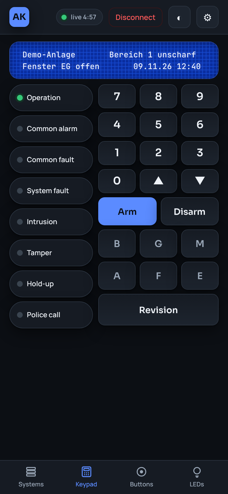
  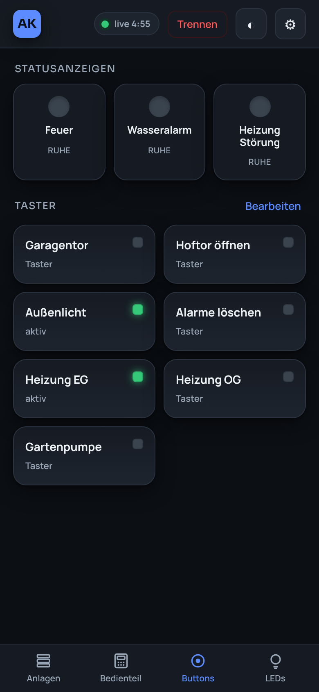
  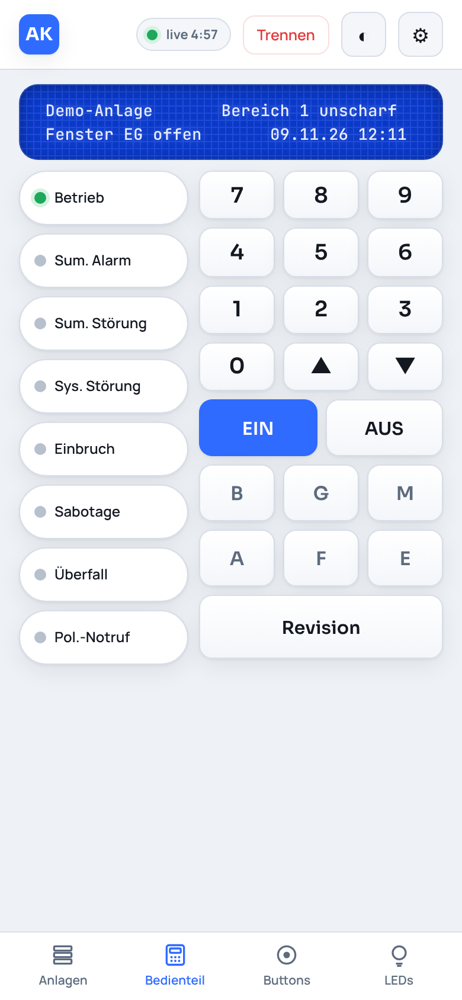
</p>
<p align="center">
  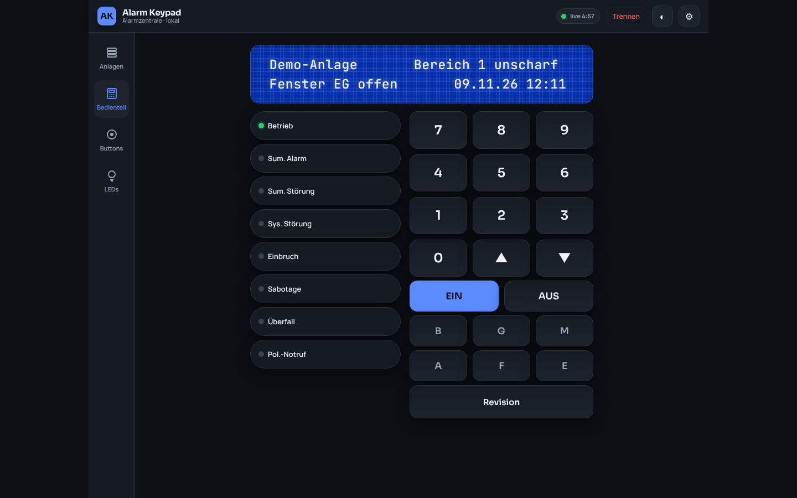
</p>

**➜ Step-by-step setup guide: [English](docs/SETUP.md) · [Deutsch](docs/SETUP.de.md)**

<sub>Screenshots use the built-in demo panel ([`tools/demo-panel.mjs`](tools/demo-panel.mjs)) with made-up data.</sub>

## Compatible systems

The app talks to the IP transmitter unit of the alarm panel with the same plain HTTP/XML
keypad protocol as the vendor's *MB-Remote Control* app, and shows the panel's keypad
(model 12540 layout: 2 × 40 LCD, 8 status LEDs, function keys), its function buttons and LEDs.

| Device | Status |
|---|---|
| Honeywell / NOVAR **DS7700** IP transmitter (reports as *DS7500 IP*), firmware `ADIST.10.0V08.05`, without AES key | ✅ Tested daily by the author: live display, buttons, LEDs |
| Other units that work with the *MB-Remote Control V2* app (e.g. other DS7500/DS7700 firmware versions) | 🟡 Very likely, not tested yet |
| Units with an AES key set in the original app | 🟡 Supported since 0.6.0 (same AES scheme as the original app), not yet tested on a real panel |

Rule of thumb: if the original *MB-Remote Control V2* app can show your keypad over the network
(default port `8016`), this app should work too. Please open an issue with your device and
firmware, working or not, so the list can grow. Product names belong to their owners and are
used only to describe compatibility; this project is not affiliated with them.

## Features

- Live display of the panel: LCD text, status LEDs, function buttons and indicator LEDs
- Virtual keypad (digits, ▲▼, Arm/Disarm, function keys, Revision) and the panel's function buttons
- **View-only by default.** Sending commands is an explicit setting (*Allow control*), off by default
- Arm/disarm and function buttons always ask for confirmation first
- **Several systems.** Add, edit, sort and delete systems in the app (name, address, port, group, optional AES key, group for Home Assistant), including remote ones via a MyFRITZ/DynDNS name. One connection at a time
- **Home Assistant entities over MQTT** (optional): the panel's LEDs, function button states and indicators as binary sensors for dashboards and automations (e.g. intrusion alerts), function buttons as HA buttons when control is allowed. A separate background session reads only the button/LED page, so it never blocks the keypad (verified on a real panel); optionally it can use a user group of its own as an extra safeguard
- **AES key** support for panels that use one; plain text otherwise
- **Connects on demand.** The panel allows only one keypad user at a time, so the add-on connects when you tap *Connect*, disconnects after 5 minutes without activity or when you tap *Disconnect*, leaving the panel free for other apps
- Responsive layout: phone (bottom tabs) and tablet/desktop (side rail, wide keypad)
- **Set up entirely in the browser**: systems, *Allow control*, refresh interval and an optional password. No config files or variables
- **English and German.** Follows the language of Home Assistant (or of the browser when running in Docker); can be fixed in the add-on options or per device in the app
- Installable as an app (PWA) on phone and desktop when served over HTTPS
- Small static Rust binary, no cloud, no account, no telemetry

## Run with Docker (without Home Assistant)

```bash
docker run -d --name alarm-keypad --restart unless-stopped \
  -p 8099:8099 -v ema-data:/data ghcr.io/pxljake/ema-webpanel:latest
```

or with [`docker-compose.yml`](docker-compose.yml): `docker compose up -d`.

Then open `http://<docker-host>:8099`. The first start walks you through it: set a password
(recommended), add your system (address, port, group) and connect. Everything is stored in the
`/data` volume (`systems.json`, `settings.json`); nothing else has to be created.

- **Synology** (Container Manager): *Registry* → search `ghcr.io/pxljake/ema-webpanel`, or
  create a *Project* with the compose file above. Map port 8099 and a folder to `/data`.
- **Proxmox**: run it in any LXC/VM with Docker, same command as above.
- The container must reach the panel (e.g. `192.168.178.99:8016`) on your LAN. Normal bridge
  networking is enough.
- Images: `linux/amd64` and `linux/arm64`, tags `latest` and the version (e.g. `0.7.0`).

### Access from outside (Cloudflare Tunnel)

The panel has no protection of its own, so do not forward port 8099 on the router. Use a
**Cloudflare Tunnel** (see the commented `cloudflared` service in the compose file) and put
**Cloudflare Access** in front of the hostname (e.g. one-time e-mail code for your address).
Also set the password in the app; it is the second lock. Over HTTPS the page can be installed
as an app ("Add to Home Screen" / "Install app").

### Password

Optional, set in *⚙ Settings → Access*. Stored as an Argon2 hash, login cookie valid 30
days, changing the password logs out all other devices, wrong attempts are slowed down. Turning
*Allow control* on asks for the password again. **Forgot it?** Delete `settings.json` in the
data volume and restart the container: the password is gone, control is back to off, your
systems stay.

## Install as Home Assistant add-on

Detailed walkthrough: [docs/SETUP.md](docs/SETUP.md) (auf Deutsch: [docs/SETUP.de.md](docs/SETUP.de.md)).

1. In Home Assistant open **Settings → Add-ons → Add-on store → ⋮ → Repositories** and add
   `https://github.com/PXLJAKE/ema-webpanel`.
2. Install **Alarm Keypad (EMA)**, open the **Configuration** tab and set the panel address
   (and user group) of your first system. Leave **Allow control** off for a first test.
3. Start the add-on and open **Alarm Keypad** in the sidebar.

(Alternatively copy the `ema-panel/` folder into your HA `/addons` share to install it as a
local add-on.)

## Options

| Option | Default | Meaning |
|---|---|---|
| `panel_host` | `192.168.178.99` | Address of the first system, used once on first start. More systems (also remote ones) are added in the app under *Systems* |
| `panel_port` | `8016` | Port of the unit |
| `user_group` | `1` | Group of the first system, the same number as in the original app |
| `control_enabled` | `false` | `false` = view only. `true` = keys/buttons send real commands. Also switchable in the app |
| `poll_interval_ms` | `1000` | How often the state is read. Also adjustable in the app |
| `mqtt_entities` | `false` | Publish LEDs, function buttons and indicators as Home Assistant entities (needs the Mosquitto broker add-on) |
| `mqtt_buttons` | `false` | Also offer the function buttons as HA buttons; only works while control is allowed |
| `language` | `auto` | `auto` follows Home Assistant (German or English, otherwise English), or fixed `en` / `de` |

The app settings win until you change an option in Home Assistant; a changed option is applied
on the next add-on start. In Home Assistant no app password is used, HA itself logs you in.

The app detects Home Assistant by the Supervisor token. Environment variables for special cases
(all optional): `PORT` (8099), `DATA_DIR` (`/data`), `UI_LANGUAGE` (`en`/`de`, default: browser), `EMA_MODE` (`standalone` or
`homeassistant`, to override the detection).

## Safety model

- Reading state never sends a command. Commands exist only behind *Allow control* (`control_enabled`), off by default; switching it on in the app needs a confirmation and, if set, the password.
- The backend accepts only a fixed whitelist of keys (no panic/duress keys exist in the UI or API).
- Every command needs an explicit tap; arm/disarm and buttons need a second confirmation.
- Commands are never retried automatically, so a press can be lost but never doubled.
- Every sent command is logged by the add-on.
- In Home Assistant, access is through HA's own authentication (Ingress); the add-on exposes no port.
- Standalone, the optional password protects every API call except the health check; for access from outside use Cloudflare Access (or a VPN) in addition.

## More screenshots

**Phone** (dark and light)

| Keypad | Buttons | LEDs | Systems | Add system | Settings |
|---|---|---|---|---|---|
|  |  | 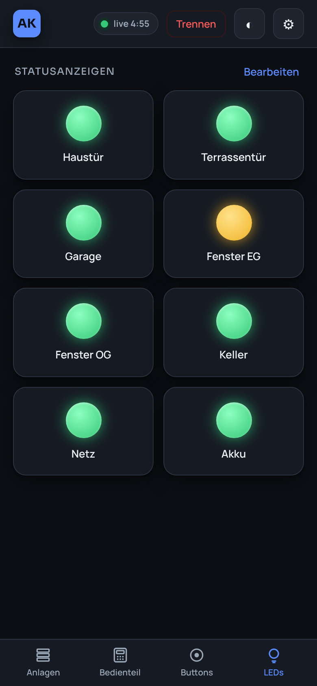 | 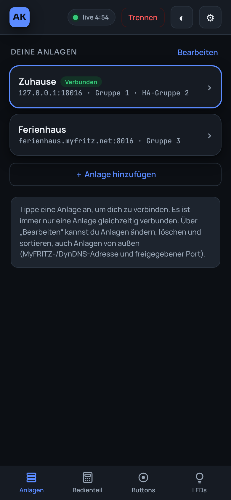 | 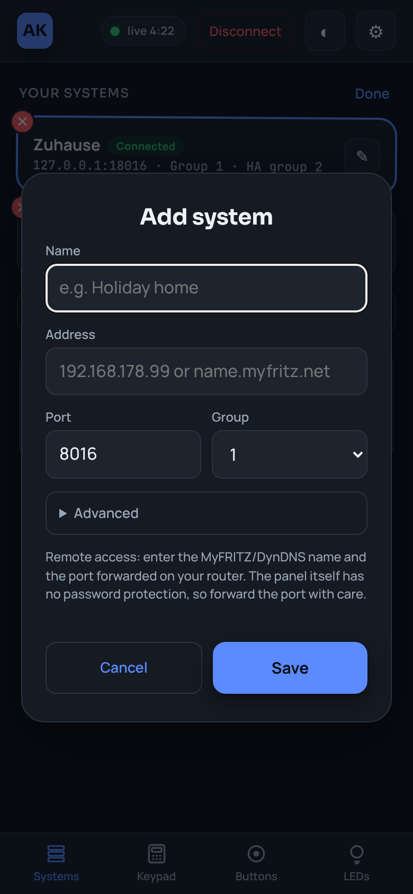 | 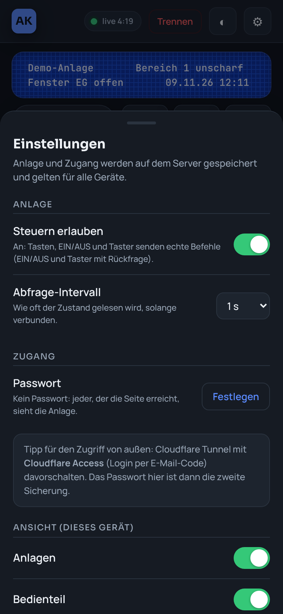 |
|  | 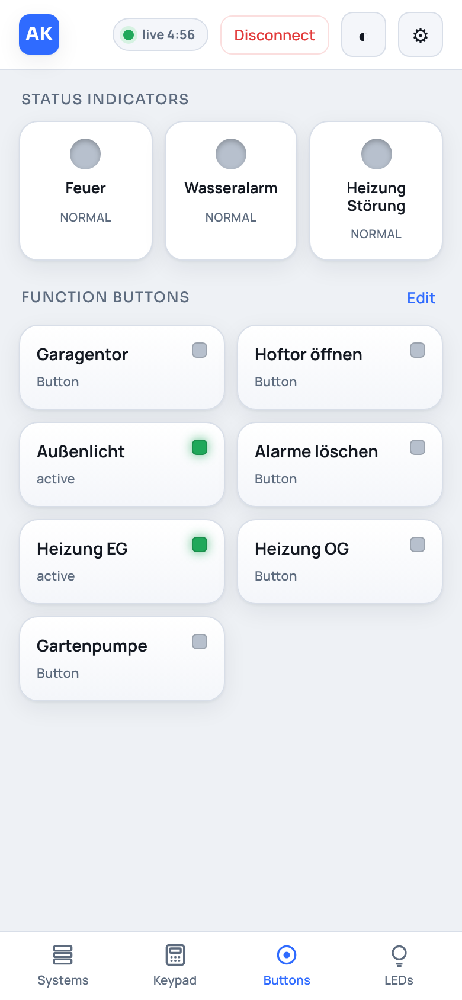 | 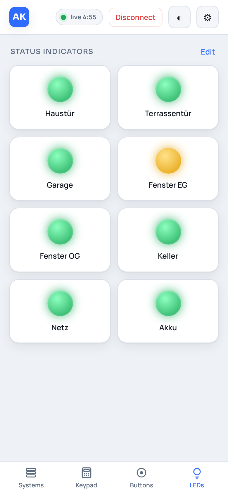 | 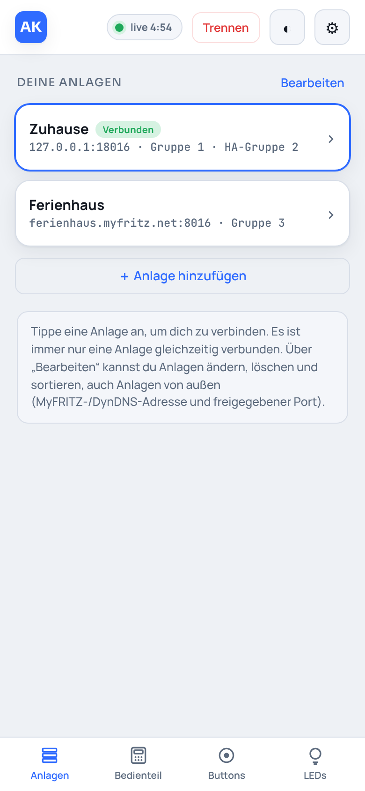 | 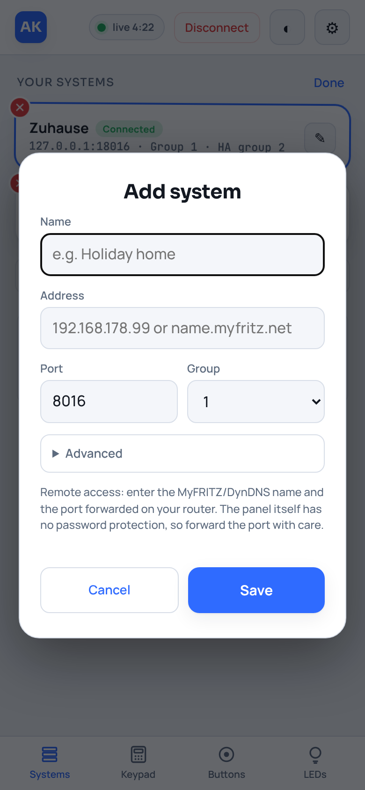 | 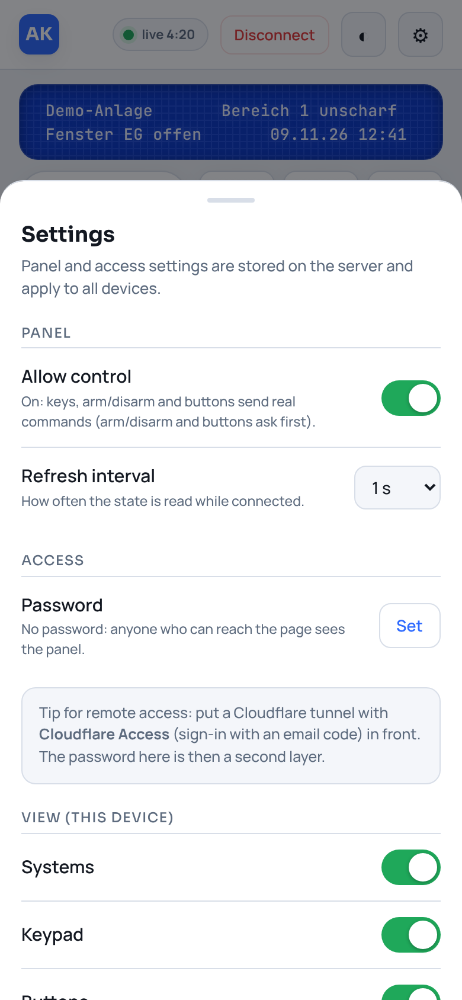 |

**Desktop / tablet**

| Dark | Light |
|---|---|
|  | 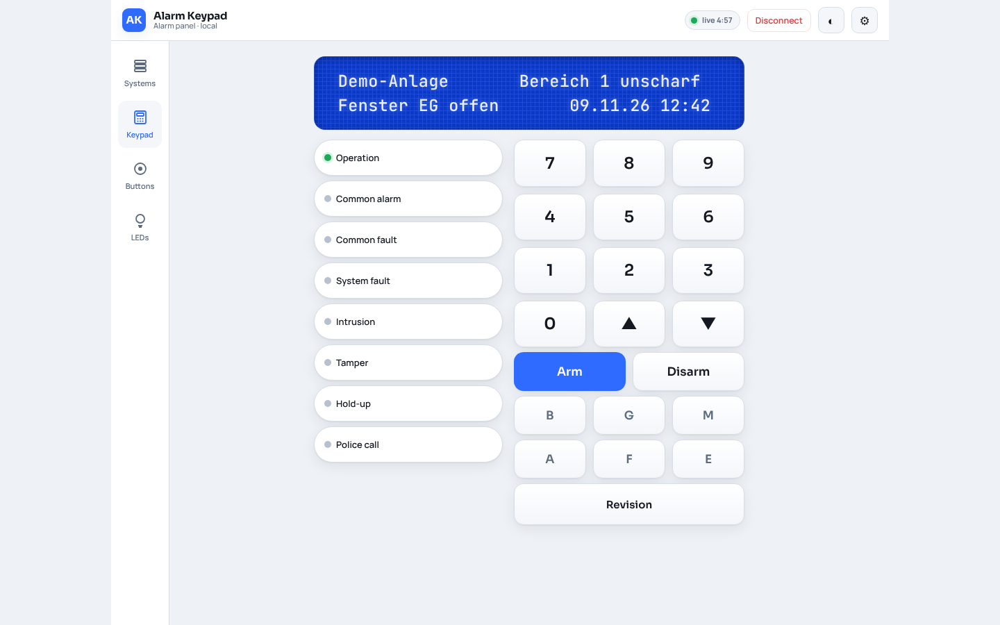 |
| 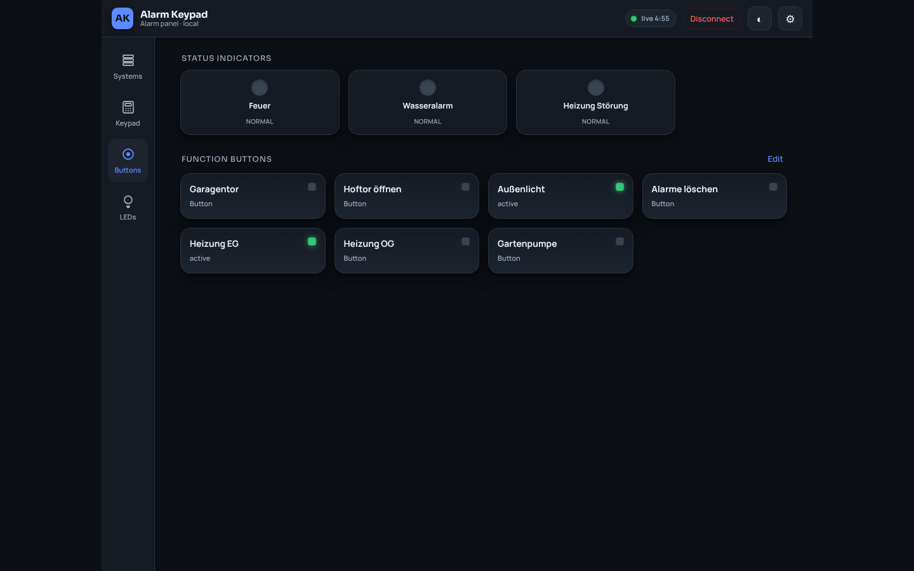 | 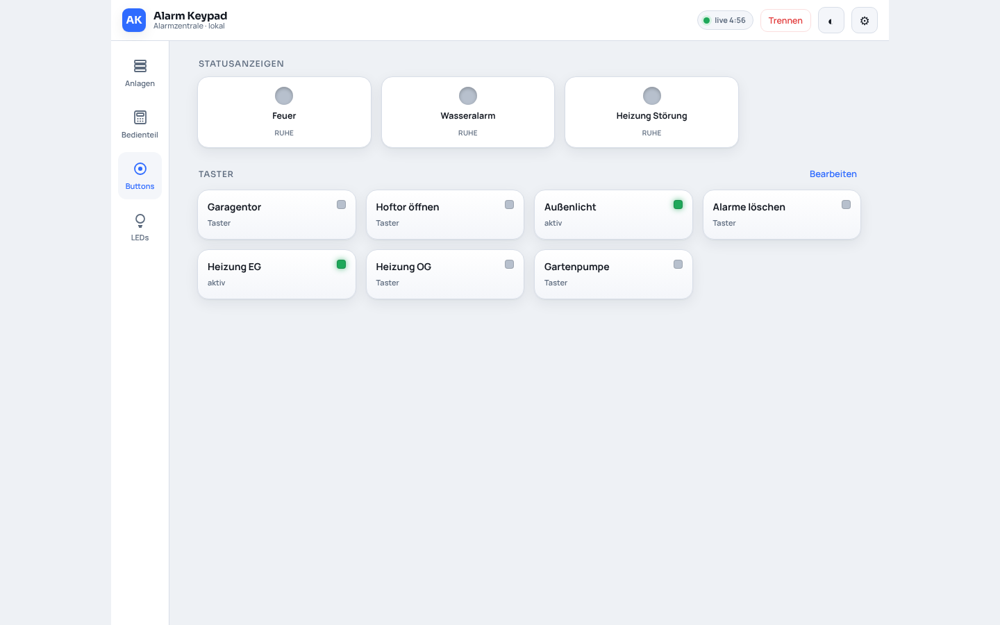 |
| 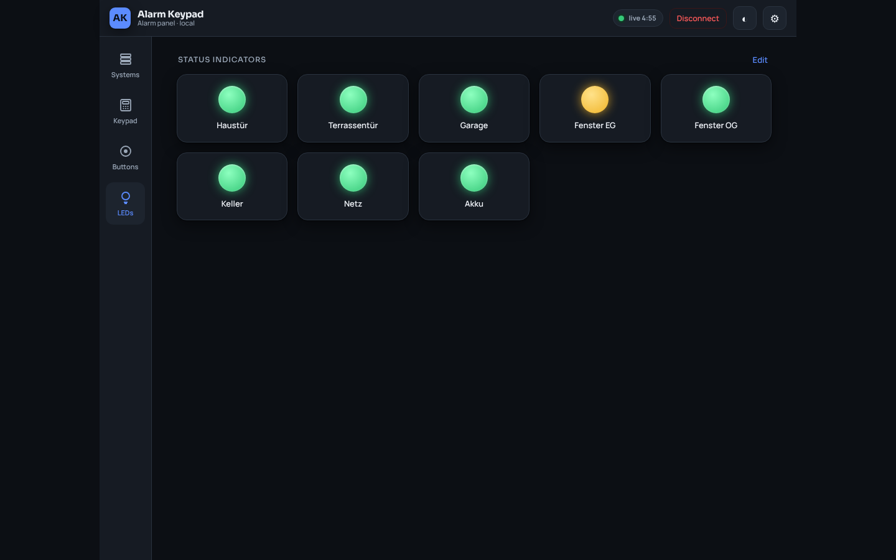 | 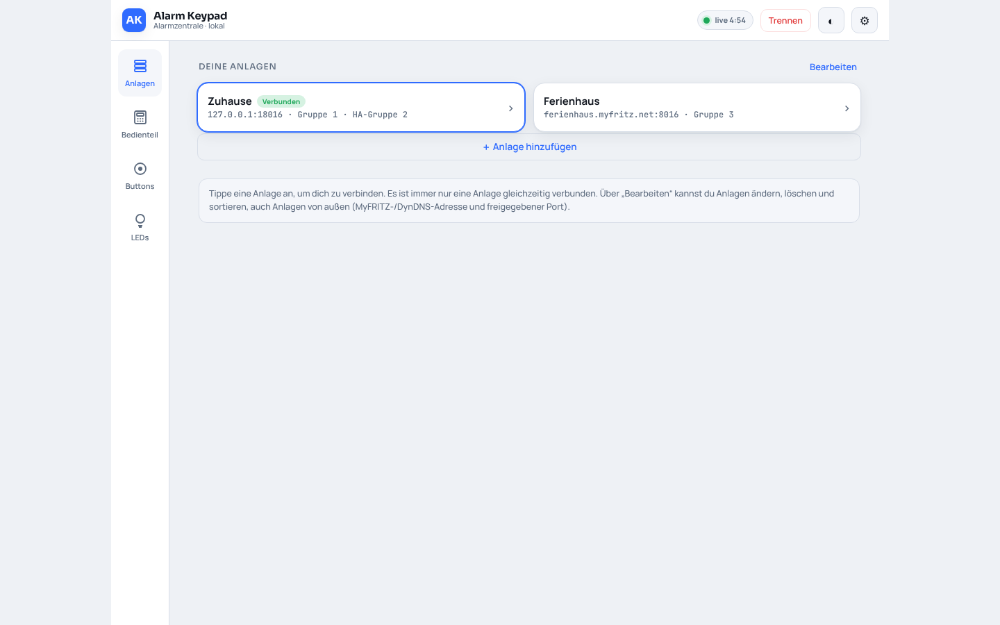 |

## Try it without a panel

```bash
node tools/demo-panel.mjs 18016          # fake panel with made-up data, commands are only logged
cd ema-panel && DATA_DIR=./data cargo run # open http://localhost:8099, add system 127.0.0.1 port 18016
```

## Development

```bash
cd ema-panel
cargo test
DATA_DIR=./data PORT=8099 cargo run      # standalone mode, set up in the browser
```

The UI is a single self-contained file, `ema-panel/web/index.html`, embedded into the binary.
All API calls are relative so it works behind the Ingress path.

## Notes

This project was written by observing the traffic of the author's own panel. No vendor code,
logos or app files are included in this repository.

## License

MIT – see [LICENSE](LICENSE).

---

### Kurz auf Deutsch

Modernes Bedienteil für eine kompatible Einbruchmeldeanlage, als Home-Assistant-Add-on oder als
Docker-Container (`docker run -p 8099:8099 -v ema-data:/data ghcr.io/pxljake/ema-webpanel`).
Eingerichtet wird alles im Browser: Anlagen, „Steuern erlauben“ und ein optionales Passwort.
Die App spricht Deutsch, wenn Home Assistant bzw. der Browser auf Deutsch steht, sonst Englisch
(Option „Sprache“ im Add-on, pro Gerät unter ⚙).
**Standardmäßig nur Ansicht**; EIN/AUS und Taster fragen immer nach. Von außen am besten über
Cloudflare Tunnel mit Cloudflare Access. Optional kommen Lampen und Taster per MQTT als
Entitäten nach Home Assistant, ohne das Bedienteil zu blockieren. Ausführliche Anleitung:
**[docs/SETUP.de.md](docs/SETUP.de.md)**. Inoffiziell, ohne Gewähr, Nutzung auf eigene Gefahr.
