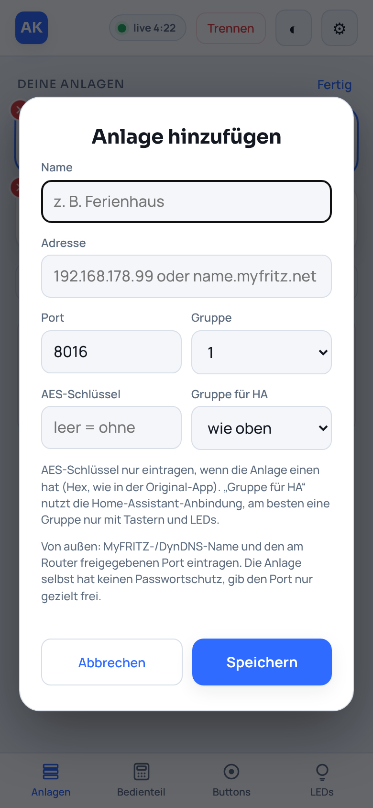

# Einrichtung Schritt für Schritt

Diese Anleitung führt dich von null bis zum fertigen Bedienteil, wahlweise als
**Home-Assistant-Add-on** oder als **Docker-Container**, und optional bis zu Sensoren und
Tastern in Home Assistant.

> Inoffizielles Projekt, ohne Gewähr. Die App bedient eine echte Alarmanlage. Lass beim ersten
> Test **„Steuern erlauben“ aus**, dann kann nichts passieren.

**Inhalt**

1. [Was du brauchst](#1-was-du-brauchst)
2. [Daten der Anlage herausfinden](#2-daten-der-anlage-herausfinden)
3. [Weg A: Home-Assistant-Add-on](#3-weg-a-home-assistant-add-on)
4. [Weg B: Docker (ohne Home Assistant)](#4-weg-b-docker-ohne-home-assistant)
5. [Anlagen anlegen und verbinden](#5-anlagen-anlegen-und-verbinden)
6. [Steuern einschalten](#6-steuern-einschalten)
7. [Sensoren und Taster in Home Assistant (MQTT)](#7-sensoren-und-taster-in-home-assistant-mqtt)
8. [Als App installieren](#8-als-app-installieren)
9. [Aktualisieren](#9-aktualisieren)
10. [Fehlerbehebung](#10-fehlerbehebung)

---

## 1. Was du brauchst

- Eine Einbruchmeldeanlage mit **IP-Übertragungseinheit**, die mit der App
  *MB-Remote Control V2* funktioniert (getestet: DS7700 bzw. „DS7500 IP“, siehe
  [Kompatibilität](../README.md#compatible-systems)).
- Die Übertragungseinheit muss im Heimnetz erreichbar sein, standardmäßig auf **Port 8016**.
- **Entweder** Home Assistant OS bzw. Supervised (für das Add-on) **oder** irgendeinen
  Docker-Host im selben Netz (Proxmox-LXC, Synology, Raspberry Pi, NAS …).
- Für Sensoren und Taster in Home Assistant zusätzlich das Add-on **Mosquitto broker**.

## 2. Daten der Anlage herausfinden

Am einfachsten schaust du in der Original-App unter **Anlagenauswahl** nach. Du brauchst:

| Angabe | Beispiel | Hinweis |
|---|---|---|
| Adresse | `192.168.178.99` | IP der Übertragungseinheit im Heimnetz. Am besten in der Fritz!Box (bzw. im Router) eine feste IP vergeben. |
| Port | `8016` | Standard. |
| Benutzergruppe | `1` | Dieselbe Nummer wie in der Original-App. |
| AES-Schlüssel | *(meist leer)* | Nur wenn in der Original-App einer eingetragen ist: 32, 48 oder 64 Hex-Zeichen. |

Kurzer Test im Browser (nur lesen, drückt nichts):
`http://192.168.178.99:8016/ui_init.xml?B-GR=1&S-ID=00&CNT=FFFF`
Kommt eine XML-Antwort mit `<Session_ID>`, ist die Anlage erreichbar. Mit AES-Schlüssel kommt
stattdessen `<crypt>…</crypt>`, auch das ist in Ordnung.

## 3. Weg A: Home-Assistant-Add-on

### 3.1 Repository hinzufügen

1. In Home Assistant **Einstellungen → Add-ons → Add-on Store** öffnen.
2. Oben rechts **⋮ → Repositories**.
3. `https://github.com/PXLJAKE/ema-webpanel` eintragen und **Hinzufügen**.
4. Fenster schließen. Im Store taucht unten **Alarm Keypad (EMA)** auf (sonst einmal
   **⋮ → Nach Updates suchen**).

### 3.2 Installieren und konfigurieren

1. **Alarm Keypad (EMA)** öffnen und **Installieren**. Das Add-on wird auf deinem
   Home Assistant gebaut, das dauert ein paar Minuten.
2. Reiter **Konfiguration**:

   | Option | Was eintragen |
   |---|---|
   | Adresse der Anlage | IP der Übertragungseinheit, z. B. `192.168.178.99` |
   | Port der Anlage | `8016` |
   | Benutzergruppe | wie in der Original-App, meist `1` |
   | Steuern erlauben | **aus** lassen |
   | Abfrage-Intervall (ms) | `1000` |
   | Entitäten in Home Assistant (MQTT) | erst einmal aus, siehe [Abschnitt 7](#7-sensoren-und-taster-in-home-assistant-mqtt) |
   | Taster in Home Assistant | aus |

   Adresse, Port und Gruppe werden nur **beim allerersten Start** als erste Anlage übernommen.
   Danach verwaltest du die Anlagen in der App (Abschnitt 5).
3. Reiter **Info**: **Starten**, und **In Seitenleiste anzeigen** einschalten.
4. In der Seitenleiste erscheint **Alarmanlage**. Ein Klick öffnet die App.

In Home Assistant meldet dich Home Assistant selbst an. Ein eigenes Passwort ist nicht nötig, das
Add-on hat auch keinen offenen Port nach außen.

## 4. Weg B: Docker (ohne Home Assistant)

### 4.1 Starten

```bash
docker run -d --name alarm-keypad --restart unless-stopped \
  -p 8099:8099 -v ema-data:/data ghcr.io/pxljake/ema-webpanel:latest
```

oder mit [`docker-compose.yml`](../docker-compose.yml) aus dem Repository: `docker compose up -d`.

- **Synology** (Container Manager): *Projekt → Erstellen*, Compose-Datei einfügen, Port 8099
  und einen Ordner für `/data` zuordnen.
- **Proxmox**: in einem LXC oder einer VM mit Docker, gleicher Befehl.
- Der Container muss die Anlage im Heimnetz erreichen. Normales Bridge-Netzwerk reicht.

### 4.2 Erster Start im Browser

1. `http://<docker-host>:8099` öffnen.
2. Der Einrichtungs-Assistent fragt nach einem **Passwort**. Empfohlen, sobald die Seite mehr
   als ein Gerät im Heimnetz erreicht. Du kannst es auch später unter ⚙ festlegen.
3. Danach legst du deine erste Anlage an (Abschnitt 5).

Alles wird im Volume `/data` gespeichert (`systems.json`, `settings.json`). Passwort vergessen?
`settings.json` löschen und den Container neu starten: Passwort weg, Steuern wieder aus, die
Anlagen bleiben.

### 4.3 Zugriff von unterwegs

Gib Port 8099 **nicht** am Router frei. Nimm einen **Cloudflare Tunnel** (in der Compose-Datei
vorbereitet) und schalte **Cloudflare Access** davor (Login per E-Mail-Code). Das Passwort in
der App ist dann die zweite Sicherung. Alternativ ein VPN (WireGuard, Tailscale, Fritz!Box-VPN).

## 5. Anlagen anlegen und verbinden

Reiter **Anlagen** (links unten am Handy, links in der Leiste am PC) → **＋ Anlage hinzufügen**.

<p align="center"></p>

| Feld | Bedeutung |
|---|---|
| Name | frei wählbar, z. B. „Zuhause“ |
| Adresse | IP oder Hostname, von außen z. B. `name.myfritz.net` |
| Port | meist `8016` |
| Gruppe | Benutzergruppe für das Bedienteil, wie in der Original-App |
| AES-Schlüssel | nur wenn die Anlage einen hat, sonst leer. Beim Bearbeiten: leer = gespeicherten behalten, `-` = Schlüssel löschen. Der Schlüssel wird nie an den Browser zurückgeschickt. |
| Gruppe für HA | Benutzergruppe der Home-Assistant-Anbindung (Abschnitt 7). „wie oben“ = dieselbe Gruppe. |

Dann die Anlage antippen und **Verbinden**. Oben steht **live** mit einem Countdown.

Wichtig zum Verständnis: Die Anlage lässt immer **nur einen** Nutzer gleichzeitig ans
Bedienteil. Deshalb verbindet sich die App nur auf Wunsch und trennt nach **5 Minuten ohne
Bedienung** oder mit **Trennen** wieder. Ist gerade jemand anderes am Bedienteil (Original-App,
zweites Gerät), zeigt das LCD „gesperrt“. Taster und LEDs gehen trotzdem.

Mehrere Anlagen lassen sich unter **Bearbeiten** sortieren und löschen. Die **erste Anlage in
der Liste** ist die, die an Home Assistant gemeldet wird.

## 6. Steuern einschalten

Erst wenn LCD, Lampen und Taster stimmen:

- Add-on: in der App **⚙ → Steuern erlauben** (oder die Add-on-Option, gilt ab dem nächsten Start).
- Docker: **⚙ → Steuern erlauben**. Ist ein Passwort gesetzt, wird es dafür noch einmal abgefragt.

Ab dann senden Ziffern und Pfeile sofort, **EIN**, **AUS** und jeder Taster fragen vorher nach.
Es gibt bewusst **keine** Panik-, Überfall- oder Notruftaste. Feuer, Wasser und Heizung sind
reine Anzeigen. Jeder gesendete Befehl steht im Log des Add-ons bzw. Containers.

## 7. Sensoren und Taster in Home Assistant (MQTT)

Damit bekommst du die Lampen und Taster der Anlage als Entitäten, für Dashboards und
Automationen, z. B. eine Einbruch-Benachrichtigung.

### 7.1 Wie das funktioniert

Das Add-on hält dafür eine **eigene, dauerhafte Verbindung**, die **nur die Taster- und
LED-Seite** liest. Das ist an einer echten Anlage geprüft: Diese Verbindung belegt das
Bedienteil **nicht**, es bleibt für dich, die Original-App und das echte Bedienteil frei.

### 7.2 Eigene Benutzergruppe (empfohlen)

Am saubersten bekommt die HA-Verbindung eine **eigene Benutzergruppe** in der Anlage, der nur
**Taster und LEDs** freigegeben sind, ohne Bedienteil. Dann kann Home Assistant das Bedienteil
schon von der Anlage aus nicht bedienen, und du legst dort auch fest, welche Taster HA schalten
darf. Wie man Gruppen einrichtet, hängt von deiner Anlage ab (Errichter-Programmierung der
Übertragungseinheit).

Beispiel: Hauptgruppe `3` für das Bedienteil, Gruppe `2` nur mit Tastern für HA. Dann bei der
Anlage **Gruppe = 3** und **Gruppe für HA = 2** eintragen. Ohne eigene Gruppe funktioniert es mit
„wie oben“ genauso, nur ohne diese zweite Sicherung.

### 7.3 Einschalten

1. Add-on **Mosquitto broker** installieren und starten, falls noch nicht vorhanden (unter
   *Einstellungen → Geräte & Dienste* sollte die Integration **MQTT** auftauchen). Benutzer und
   Passwort holt sich das Add-on automatisch.
2. Im Add-on **Alarm Keypad (EMA)** → **Konfiguration**: **Entitäten in Home Assistant (MQTT)**
   einschalten, speichern, Add-on **neu starten**.
3. Unter *Einstellungen → Geräte & Dienste → MQTT* erscheint ein Gerät mit dem Namen deiner
   Anlage.

Docker ohne Home Assistant, aber mit eigenem Broker: `-e MQTT_ENTITIES=1 -e MQTT_HOST=… -e
MQTT_PORT=1883 -e MQTT_USER=… -e MQTT_PASSWORD=…` (optional `-e MQTT_BUTTONS=1`).

### 7.4 Was es gibt

| Entität | Art | Wann verfügbar |
|---|---|---|
| Die 8 LEDs der LED-Seite (z. B. „Einbruch Haus“) | Binärsensor | immer |
| Status der 8 Taster (z. B. „Weihnachtsbel. Status“) | Binärsensor | immer |
| Feuer, Wasseralarm, Heizung Störung | Binärsensor | immer |
| Verbindung zur Anlage | Binärsensor (Diagnose) | immer |
| Status Betrieb, Einbruch, Sabotage, Überfall, Störungen … | Binärsensor | nur solange das Bedienteil in der App offen ist |
| Die Taster selbst | Schaltfläche | nur wenn **Steuern erlauben** **und** **Taster in Home Assistant** an sind |

Blinken zählt als „an“. Jede Lampe hat die Attribute `color` und `blink`. Die Namen kommen aus
der Anlage, leere Plätze werden weggelassen.

Die Statuslampen des Bedienteils (Betrieb, Einbruch usw.) liefert die Anlage nur über die
Bedienteil-Seite. Sie dauerhaft abzufragen würde das Bedienteil sperren, deshalb sind sie nur
aktuell, solange du es in der App offen hast. Für Alarm-Automationen nimm die LEDs der LED-Seite
(z. B. „Einbruch Haus“), die sind immer da.

### 7.5 Taster aus Home Assistant schalten

1. In der App **Steuern erlauben** einschalten.
2. Add-on-Option **Taster in Home Assistant** einschalten und neu starten.

Die Schaltflächen erscheinen dann am Gerät. Schaltest du Steuern wieder aus, verschwinden sie
aus Home Assistant, und Drücke von HA werden ignoriert. Achtung: Schaltflächen in Home Assistant
fragen **nicht** nach. Überleg dir, welche Automationen sie drücken dürfen.

### 7.6 Beispiel: Einbruch-Benachrichtigung

Die Entity-ID findest du am Gerät (z. B. `binary_sensor.zuhause_einbruch_haus`).

```yaml
alias: Einbruch melden
triggers:
  - trigger: state
    entity_id: binary_sensor.zuhause_einbruch_haus
    to: "on"
actions:
  - action: notify.mobile_app_dein_handy
    data:
      title: "Alarmanlage"
      message: "Einbruch Haus ausgelöst!"
      data:
        push:
          interruption-level: critical
mode: single
```

Und eine einfache Dashboard-Karte:

```yaml
type: entities
title: Alarmanlage
entities:
  - binary_sensor.zuhause_verbindung_zur_anlage
  - binary_sensor.zuhause_einbruch_haus
  - binary_sensor.zuhause_feuer
  - binary_sensor.zuhause_wasseralarm
```

## 8. Als App installieren

Die Seite lässt sich wie eine App installieren, sobald sie über **HTTPS** erreichbar ist (z. B.
über den Cloudflare Tunnel): am Handy **Teilen → Zum Home-Bildschirm** (iPhone) bzw. **⋮ → App
installieren** (Android, Chrome), am PC über das Installieren-Symbol in der Adressleiste. In Home
Assistant nutzt du einfach die HA-App, dort ist das Bedienteil in der Seitenleiste.

## 9. Aktualisieren

- **Add-on**: Home Assistant zeigt Updates unter *Einstellungen → Add-ons*. Falls nicht: im Store
  **⋮ → Nach Updates suchen**. Das Add-on wird lokal gebaut (ein paar Minuten).
- **Docker**: `docker pull ghcr.io/pxljake/ema-webpanel:latest` und Container neu erstellen
  (`docker compose pull && docker compose up -d`).

Deine Anlagen und Einstellungen bleiben in beiden Fällen erhalten.

## 10. Fehlerbehebung

| Problem | Lösung |
|---|---|
| „nicht verbunden“ | Adresse, Port und Gruppe prüfen. Unter **⚙ → Verbindung testen** siehst du die rohe Antwort der Anlage. Ist der Browser-Test aus Abschnitt 2 erfolgreich? |
| LCD zeigt „gesperrt“ | Jemand anderes ist am Bedienteil (Original-App, zweites Gerät). Dort trennen oder warten. Taster und LEDs gehen trotzdem. |
| „Die Anlage antwortet verschlüsselt“ | Die Anlage hat einen AES-Schlüssel: bei der Anlage eintragen. |
| „Entschlüsseln fehlgeschlagen“ | AES-Schlüssel falsch. Neu eintragen. |
| HA-Entitäten fehlen | Läuft Mosquitto? Option **Entitäten in Home Assistant** an und Add-on neu gestartet? Im Add-on-Log steht „MQTT verbunden“ und „Hintergrund-Sitzung gestartet“. |
| HA-Entitäten „nicht verfügbar“ | Die Hintergrund-Verbindung erreicht die Anlage nicht, oder die HA-Gruppe hat keine Rechte. Log prüfen. |
| Statuslampen in HA „nicht verfügbar“ | Normal, solange das Bedienteil in der App nicht offen ist (Abschnitt 7.4). |
| Keine Taster-Schaltflächen in HA | **Steuern erlauben** und **Taster in Home Assistant** müssen beide an sein. |
| Anlage nimmt keine Verbindung an | Sie erlaubt nur wenige Sitzungen gleichzeitig. Andere Apps schließen, kurz warten. |
| Beim Update „exit code 137“ im Log | Harmlos: der alte Container wurde beim Update hart beendet. |
| Umlaute im LCD falsch | **⚙ → Verbindung testen** öffnen und die Rohdaten in einem Issue melden. |
